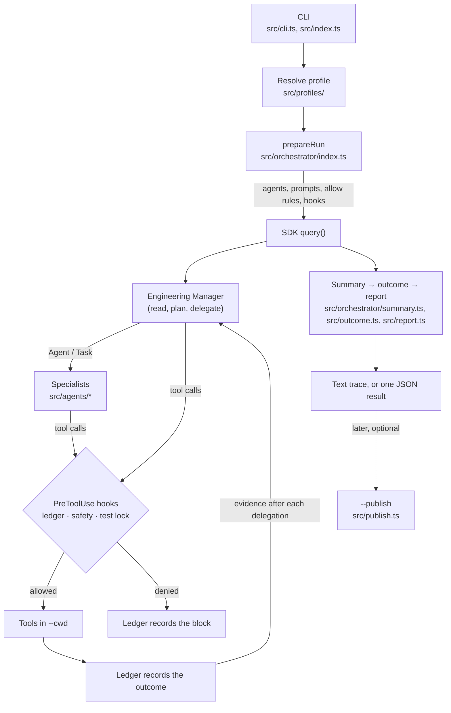

# How it works

The moving parts of a run: what each one does, where it lives, and how they fit together. Read this before [extending.md](extending.md). The safety layer's limits are in [security.md](security.md).

**Contents**

1. [The big picture](#1-the-big-picture)
2. [A run, step by step](#2-a-run-step-by-step)
3. [Source map](#3-source-map)
4. [The team](#4-the-team)
5. [Prompts](#5-prompts)
6. [Profiles](#6-profiles)
7. [The safety layer](#7-the-safety-layer)
8. [Evidence: ledger, test lock and outcome](#8-evidence-ledger-test-lock-and-outcome)
9. [Publishing](#9-publishing)
10. [Trust boundaries](#10-trust-boundaries)

## 1. The big picture

software-dev-team is a thin harness around one Claude Agent SDK `query()`. The model at the top is an **Engineering Manager**. It can only read, plan and delegate; specialists defined as SDK subagents do the work. The harness adds:

- the team's prompts and profiles;
- a safety hook that screens every tool call;
- a ledger that records what actually ran;
- a lock that keeps qa-tester's acceptance tests out of other roles' hands;
- a result the caller can rely on.



## 2. A run, step by step

1. **Parse** (`src/cli.ts`). `parseArgs` turns the arguments into one of `run`, `roles`, `profiles`, `publish` or `help`. `checkProjectDir` validates `--cwd`.
2. **Resolve the profile** (`src/profiles/registry.ts`):
   - A built-in id, a module path, or detection from `--cwd`.
   - `checkProfileRoot` refuses a `--cwd` that isn't the profile's project root.
3. **Prepare** (`prepareRun` in `src/orchestrator/index.ts`):
   - It loads the project's prompt customizations and its own agents (`src/prompts.ts`, `src/project-agents.ts`).
   - It builds the specialists (`loadTeam` in `src/team.ts`) and the manager's prompt (`loadOrchestratorPrompt`).
   - It validates the allow rules (`src/allowlist.ts`).
   - It creates the safety policy (`createPolicy` in `src/permissions.ts`), the ledger (`src/ledger.ts`) and the test lock (`src/test-authorship.ts`).
   - It assembles the SDK options, listed below.
4. **Run** (`runTeam`). The SDK stream is consumed message by message:
   - `foldMessage` builds the run summary.
   - The renderer prints the trace (`src/render.ts`).
   - The ledger observes refusals.

   A renderer or ledger failure is logged and skipped, never fatal. At the end, `finishSummary` turns a stream with no result into an error.

5. **Finish** (`src/index.ts`).
   - `runOutcome` decides the exit code and the warning (`src/outcome.ts`).
   - The ledger and acceptance tests are printed. In JSON mode, `buildJsonResult` writes one object (`src/report.ts`).

The SDK options `prepareRun` sets:

| Option           | Value                                                                                              |
| ---------------- | -------------------------------------------------------------------------------------------------- |
| `agents`         | The team, as SDK subagent definitions                                                              |
| `systemPrompt`   | Claude Code's preset, with the manager's prompt appended                                           |
| `tools`          | Claude Code's preset tool set                                                                      |
| `allowedTools`   | `Grep`, `Glob`, the profile's `allow`, then `--allow`                                              |
| `permissionMode` | `acceptEdits` with `--yes`, else `default`                                                         |
| `canUseTool`     | The interactive approval gate; installed only without `--yes`                                      |
| `hooks`          | PreToolUse: ledger, safety, test lock. PostToolUse: ledger, test lock. PostToolUseFailure: ledger. |
| `settingSources` | `["project"]`: the target's `.claude` settings, hooks, agents, CLAUDE.md and `.mcp.json`           |
| `plugins`        | The team plugin in `plugin/` (its skills)                                                          |
| `env`            | The process environment plus `CLAUDE_AGENT_SDK_DISABLE_BUILTIN_AGENTS=1`                           |
| `maxTurns`       | `--max-turns`, default 60                                                                          |
| `maxBudgetUsd`   | `--max-budget`; set only when given                                                                |
| `model`          | `--model`; set only when given                                                                     |
| `resume`         | `--resume`; set only when given                                                                    |

## 3. Source map

| Path                               | Responsibility                                                                                              |
| ---------------------------------- | ----------------------------------------------------------------------------------------------------------- |
| `src/index.ts`                     | Entry point: dispatches each command, prints the end-of-run report, maps outcomes to exit codes, emits JSON |
| `src/cli.ts`                       | Argument parsing, `--help` text, `--cwd` checks                                                             |
| `src/orchestrator/index.ts`        | `prepareRun` (everything a run needs) and `runTeam` (consumes the stream); the manager's prompt assembly    |
| `src/orchestrator/prompt.md`       | The manager's prompt                                                                                        |
| `src/orchestrator/summary.ts`      | Folds SDK messages into a run summary that never hides an error                                             |
| `src/agents/<role>/`               | Each specialist: `index.ts` (definition) and `prompt.md` (prompt)                                           |
| `src/agents/index.ts`              | `AGENTS`, the team in roster order; `ROLES` and `TeamRole` derive from it                                   |
| `src/agents/shared.ts`             | Tool presets, turn caps, the `advisory`/`implementer`/`reviewer` helpers, the plugin name and path          |
| `src/agents/team/prompt.md`        | Conventions every specialist shares                                                                         |
| `src/team.ts`                      | `loadTeam`: applies a profile and customizations to each role's prompt                                      |
| `src/prompts.ts`                   | Prompt loading, `<section>` parsing, `{{placeholder}}` rendering, `.claude/dev-team/` customizations        |
| `src/profiles/`                    | Profile types, composition (`extends`), the registry and the built-in profiles                              |
| `src/project-agents.ts`            | Loads and vets the target repository's `.claude/agents`                                                     |
| `src/permissions.ts`               | The safety policy, the PreToolUse safety hook, the interactive approval gate                                |
| `src/permissions/shell.ts`         | Bash rules: hard denies, secret and environment reads, protected-path mentions, git read confinement        |
| `src/permissions/paths.ts`         | Secret paths, protected write paths, symlink-aware path resolution                                          |
| `src/permissions/globs.ts`         | Glob matching for secret families                                                                           |
| `src/permissions/git.ts`           | git option normalization and config checks                                                                  |
| `src/allowlist.ts`                 | Allow-rule validation and read roots                                                                        |
| `src/tools.ts`                     | Tool names and the lists the policy keys on: `WRITE_TOOLS`, `DELEGATION_TOOLS`, `MANAGER_ALLOWED`           |
| `src/ledger.ts`                    | Records every call and its outcome; builds the evidence the manager gets after each delegation              |
| `src/test-authorship.ts`           | The acceptance-test lock                                                                                    |
| `src/outcome.ts`                   | Exit code and warning from the summary and ledger                                                           |
| `src/report.ts`                    | Parses the manager's report; builds the JSON result                                                         |
| `src/changed-files.ts`             | `team.changed_files` from `git status`                                                                      |
| `src/render.ts`                    | The text-mode trace                                                                                         |
| `src/publish.ts`                   | The model-free commit-and-push step                                                                         |
| `plugin/`                          | The team's Claude Code plugin; its `skills/` are preloaded by roles (code-reviewer's `code-review`)         |
| `scripts/check-sdk-permissions.ts` | Live check of the SDK's own permission matching ([testing.md §7](testing.md#7-live-and-manual-checks))      |

## 4. The team

The manager isn't a role in `AGENTS`. It is the top-level session, and the safety hook confines it to `MANAGER_ALLOWED`: Read, Grep, Glob, Agent, Task, TodoWrite and ToolSearch.

| Role                | Model  | Tools (preset)                          | Turns | Routed to for                                                                  |
| ------------------- | ------ | --------------------------------------- | ----- | ------------------------------------------------------------------------------ |
| product-manager     | opus   | read-only                               | 30    | Turning a vague request into a scoped, testable spec; first on any new feature |
| architect           | opus   | read-only                               | 30    | Structure and tradeoffs for anything spanning modules, data flow or boundaries |
| ux-designer         | opus   | read-only                               | 30    | User flows, interaction states and accessibility, before building any screen   |
| backend-engineer    | sonnet | implementer                             | 60    | Server-side APIs, business logic, jobs and integrations                        |
| frontend-engineer   | sonnet | implementer                             | 60    | Web UI, client state and browser-side data fetching                            |
| mobile-developer    | sonnet | implementer                             | 60    | React Native / Expo features, native modules, offline behavior                 |
| database-specialist | sonnet | implementer                             | 60    | Schemas, migrations, indexes and slow queries                                  |
| qa-tester           | opus   | implementer                             | 60    | Test-first acceptance tests, and adversarial verification of finished work     |
| code-reviewer       | opus   | reviewer + `dev-team:code-review` skill | 60    | Reviewing every implementation with severity and confidence ratings            |
| monetization-expert | opus   | read-only                               | 30    | Pricing, packaging, billing logic, paywalls and upgrade paths                  |
| business-strategist | opus   | read-only                               | 30    | Prioritization and build/buy/kill decisions                                    |

Presets (`src/agents/shared.ts`):

- **read-only:** Read, Grep, Glob, WebSearch and WebFetch.
- **implementer:** read-only plus Write, Edit and Bash.
- **reviewer:** Read, Grep, Glob and Bash, with no web tools.

Each role's model is **pinned**: the safety hook refuses a delegation that overrides it. A profile can change a role's model, tools and caps, or add roles ([§6](#6-profiles)).

**The manager's workflow** (its `<workflow>` section):

1. Plan first.
2. Settle decisions before implementation.
3. Route by domain.
4. Tests first: qa-tester writes failing acceptance tests and quotes them failing.
5. Run independent work in parallel.
6. Send every implementation to code-reviewer and qa-tester together.
7. Run at most three review cycles.

Its `<quality_bar>` holds each claim to the harness record. The ledger must show an acceptance test failing in qa-tester's test-first delegation and passing after the implementation.

**What every specialist shares** (`src/agents/team/prompt.md`):

| Section           | Covers                                                                                                  |
| ----------------- | ------------------------------------------------------------------------------------------------------- |
| `<handoff>`       | The brief is the specialist's whole context.                                                            |
| `<repository>`    | Cite `path:line`, follow the repository's conventions, and leave changes uncommitted.                   |
| `<test_first>`    | The acceptance tests define done, and can't be edited by anyone but qa-tester.                          |
| `<safety>`        | What the safety layer blocks, and how to report a block.                                                |
| `<report_format>` | A `Status: done \| partial \| blocked \| needs-decision` line, the role's sections, then `Follow-ups:`. |

## 5. Prompts

Prompts are Markdown files made of top-level sections:

```text
<role>
…
</role>

<standards>
…
</standards>
```

A section is a line `<name>`, its content, then a line `</name>` (`SECTION` in `src/prompts.ts`). Sections are the unit profiles and projects replace. `loadPrompt` normalizes bytes (BOM, CRLF, trailing newlines) so prompts are stable for prompt caching. Prettier is told never to format `prompt.md` files.

**Placeholders.** `{{name}}` is filled by `renderPrompt`, which is strict: an unknown name, a malformed one, or a stray `{{` or `}}` throws. The only placeholder in use is `{{roster}}`, in the manager's `<team>` section. It is rendered from the profile's members as `- <role>: <description>`.

**A specialist's prompt** (`loadTeam` in `src/team.ts`), in order:

1. The built-in `prompt.md`.
2. The profile's overlay:
   - `identity` replaces `<role>`;
   - `core` replaces `<standards>` and removes `<workflow>`;
   - `outputFormat` replaces `<output_format>`.

   A role the profile adds is built from `identity`, `core` and `outputFormat` alone.

3. A `<project>` section, when the profile has material for this role. It holds `## Project: <name>` with the shared context, `## Your role on this project`, `## Specialist expertise` and `## Project standards`.
4. The project's `<role>.replace.md` or `<role>.<section>.md`. A replacement replaces steps 1–3 too.
5. The shared team conventions, with the project's `team.*` files applied.
6. The project's `<role>.md`, appended under `## Instructions from this project`.

**The manager's prompt** (`loadOrchestratorPrompt`), in order:

1. `orchestrator/prompt.md`, or the project's `orchestrator.replace.md`.
2. `{{roster}}` is rendered.
3. Unless the prompt was replaced, the profile's `<project>` and `<project_routing>` sections are appended. Routing rules there win over the general ones.
4. Section overrides are applied. In them, `{{roster}}` is the only placeholder filled.
5. A check that the roster is present.
6. The project's `orchestrator.md` is appended.

The result goes into the SDK as `systemPrompt: { type: "preset", preset: "claude_code", append: … }`.

With the `generic` profile and no customizations, nothing is added: the prompts are exactly the built-in team. A test enforces that.

## 6. Profiles

A **profile** (`ProjectProfile` in `src/profiles/types.ts`) carries a project's knowledge:

- shared `context` for every agent;
- `routing` rules for the manager;
- `allow` rules for its own commands;
- an optional `detect(cwd)`, and `root(cwd)`;
- `shadowedProjectAgents`;
- per-role **overlays** (`RoleOverlay`).

An overlay can:

- disable a role;
- change its `description`, `model`, `tools` or `maxTurns`;
- replace its `identity`, `core` or `outputFormat`;
- add `expertise`, `standards` and `context`.

**Composition** (`composeProfile` in `src/profiles/compose.ts`) walks the `extends` chain from the root down:

| Field                                                                                                       | Down the chain                           |
| ----------------------------------------------------------------------------------------------------------- | ---------------------------------------- |
| Overlay scalars: `enabled`, `description`, `model`, `tools`, `maxTurns`, `identity`, `core`, `outputFormat` | The child's value wins.                  |
| Overlay `expertise`, `standards`, `context`                                                                 | Accumulate, parent first.                |
| Profile `context`, `routing`                                                                                | Accumulate, parent first.                |
| Profile `allow`, `shadowedProjectAgents`                                                                    | Accumulate, parent first, de-duplicated. |
| `root`                                                                                                      | The most specific one set.               |

Members come out as the team roles in roster order, then the roles the profile adds. A profile that disables every role is refused, and so is one with an unknown parent or an `extends` cycle. How to write a profile is in [extending.md §2](extending.md#2-profiles).

**Built-in profiles** (`BUILT_IN_PROFILES` in `src/profiles/registry.ts`):

- **`generic`:** no material.
- **`recovery-platform`:** its root is wherever `recovery-api/src/config/apps.ts` is found walking up. It adds monorepo rules, exact `npm --prefix <pkg> …` and git read commands, two routing rules and two qa-tester standards, and marks the repository's own `product-manager` agent as a known shadow (`shadowedProjectAgents`).
- **`regroup`:** extends `recovery-platform`. It overlays every role except code-reviewer, and adds `web-engineer` (`src/profiles/regroup/{product,client,server}.ts`).

## 7. The safety layer

Four layers stand between a model and the project. [security.md §1](security.md) has the full table and every known limit.

1. **The PreToolUse safety hook** (`createSafetyHooks`):
   - It runs on every tool call, in every permission mode, inside every specialist.
   - The manager may use only `MANAGER_ALLOWED` tools.
   - Every other call goes to `denyReason`, the single source of what is forbidden:
     - a call containing a credential's value from the environment;
     - a delegation to an agent not on the team, or one that overrides a pinned model or asks for isolation;
     - Bash rejected by `bashDenyReason` (`src/permissions/shell.ts`);
     - reading a secret path;
     - Grep content from outside the read roots;
     - file-tool writes outside the project or to protected paths (`.git/`, `.claude/`, `.mcp.json`, `CLAUDE.md`, CI workflows, git hooks).
   - It forces delegations and Bash to the foreground, so the ledger sees their results.
   - Any exception inside the hook is a deny.
2. **Permission rules.** The SDK approves what `acceptEdits` and the allow rules cover. Under `--yes` it refuses the rest. Without `--yes`, the approval gate (`createPermissionGate`) asks on stderr, after running `denyReason` again. Reads outside the read roots need approval (`approvalReason`).
3. **The test lock.** See [§8](#8-evidence-ledger-test-lock-and-outcome).
4. **The container**, when deployed: no credentials but the model key, no network beyond the API, read-only root, non-root user ([deployment.md](deployment.md)).

`bashDenyReason` checks each command in several spellings: raw, dequoted, with git's long options expanded, and with git's global options dropped (some rules match only that last form). Wrappers such as `env`, `bash -c` and `npx` are handled by the patterns themselves. That way a quoting trick or a wrapper doesn't hide a blocked command. It is pattern-based and best-effort. The container is the boundary that must hold if a rule is bypassed ([security.md S10](security.md)).

## 8. Evidence: ledger, test lock and outcome

**The ledger** (`src/ledger.ts`) records every tool call through the hooks and the stream:

- the role that made it;
- the tool and a detail (the command, the path, `→ <agent>`);
- its outcome: `ok`, `failed`, `started` (background), `blocked`, `refused` or `unfinished`.

Successful reads (Read, Grep, Glob, TodoWrite, ToolSearch, WebSearch) are left out. Credential values are redacted. Faults are counted, never thrown.

**Evidence after each delegation.** When an Agent or Task call returns, the ledger hands the manager a record of what that specialist ran. Calls that need attention are always listed; the rest fill in from the most recent, up to 30 rows, and older successful rows collapse into one line. The manager's prompt tells it to treat a claim the record doesn't support as unverified. If the record is unavailable, the whole report is unverified.

**The test lock** (`src/test-authorship.ts`). Once qa-tester writes a file that `isTestPath` recognizes as a test, every other role's file-tool write to it is denied. Test files are recognized by layout and naming: `*.test.*`, `__tests__/`, `test_*.py`, `*Tests.cs` and so on. The lock follows the file through renames, hard links and case changes, by device and inode as well as path. Source stubs qa-tester adds stay editable. Shell writes aren't tracked ([security.md S7](security.md)). The locked files become `team.acceptance_tests`.

**The summary** (`src/orchestrator/summary.ts`) folds the stream:

- The session id is captured from the first message, so a crashed run can still be resumed.
- An earlier error is never hidden by a later success.
- Permission denials are de-duplicated.
- A stream that ends without a result is an error.

**The outcome** (`src/outcome.ts`). The exit code is:

- 1 on error;
- 3 with `--strict` when something needs a check;
- else 0.

"Needs a check" means:

- the ledger has calls that are failed, blocked, refused, started or unfinished (a failed Bash call that a later run of the same command by the same specialist passed doesn't count);
- the ledger missed events;
- or the run started with configuration warnings.

**The report** (`src/report.ts`) parses the manager's final message:

- the word after `Outcome:`;
- a `Question:` (kept only for `needs-decision` or `blocked`);
- a `Commit message:`.

It builds the JSON result, which never reports a failed run as a success.

## 9. Publishing

`--publish` (`src/publish.ts`) is deliberately separate from the run. It runs no model, so the GitHub write token lives in a process with no agent in it.

1. It validates the result and skips anything not `done`; `partial` is allowed with `--include-partial`.
2. It refuses the default branch and secret files.
3. It switches to the branch, stages, and re-checks what is staged.
4. It commits with the repository's hooks.
5. It runs `pre-push` itself, with `git push`'s arguments and stdin.
6. It pushes without force and with no hooks. That is the one process that holds the token.

Every git call except the push runs without the token in its environment ([security.md S8](security.md)).

## 10. Trust boundaries

- **`--cwd` is trusted.** The run loads the target's `.claude` settings, hooks, agents and `.mcp.json`. Its hooks run as its own code. Its `permissions.allow` rules can't weaken the safety hook, because a PreToolUse deny wins.
- **The team is not trusted.** Assume any agent may follow injected instructions found in the repository or the task. Each layer above is judged by what it stops.
- **Code the team writes runs.** An approved test command runs team-written tests with the process's access. That is inherent in letting the team test its work, and why the container has no credentials and no general network ([security.md S4](security.md)).
- **The publish step holds the only write credential**, and its hooks never see it.
